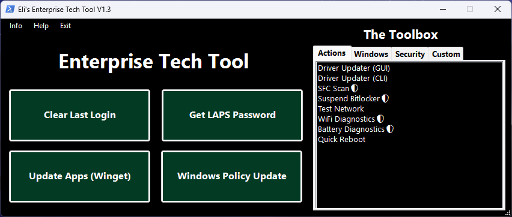
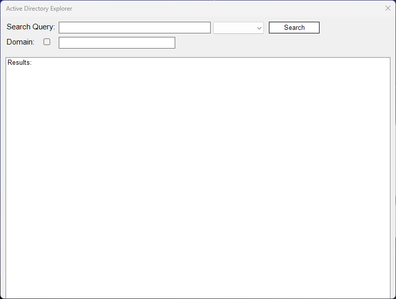
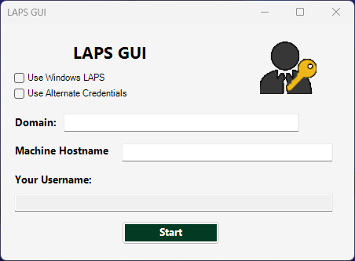

# 🚀 Eli's Enterprise Tech Toolkit!

[](https://img.shields.io/github/license/eliweitzman/enterprisetechtool?link=https%3A%2F%2Fgithub.com%2Feliweitzman%2FEnterpriseTechTool%2Fblob%2Fmain%2FLICENSE
) [](https://github.com/eliweitzman/EnterpriseTechTool/releases)  

Welcome to Eli's Enterprise Tech Tool (ETT, or Enterprise Tech Tool, for short). In this project, I hope to combine a bunch of useful sysadmin/helpdesk solutions that could be potentially helpful in general field work. ETT is an all-in-one power tool for Windows, built as a PowerShell script. Designed with IT professionals in mind, this application is customizable, and feature-packed with tons of admin tools to make life easier. Most of these projects are made from ideas I've had while at work, but hopefully some new functions come about soon!

## Features

<p align="center">
  
</p>

### Core Functions

- Clear Last Windows Session Login
- Retreive Microsoft and Windows LAPS passwords from On-Prem AD (Azure AD Windows LAPS now available!)
- Update all apps (using Windows Package Manager)
- Update Device Policy (gpupdate)
- System-aware dark/light mode!
- Retreive device information details
- Set hardware/software compliance flags
- Embed custom powershell scripts
- And more!

### Additional Modules!

- AD Explorer Pop-out! (Uses RSAT AD Tools)

<p align="center">
  
</p>

- LAPS Pop-out!

<p align="center">
  
</p>

_A standalone version of the LAPS client currently lives at [https://github.com/eliweitzman/ETT-LAPS](https://github.com/eliweitzman/ETT-LAPS) in case you don't want to download the whole toolkit! Version updates for this will be updated in sequence, but all changes will be made here in ETT._

## Recommended Experience before deployment

While it's optional, and I try to add as much context and instructions to the project as possible to run without experience, it would be good to have some experience in the following tools:

- PowerShell
- Windows PowerShell ISE
- Active Directory

## Runtime Options

ETT can run in a few different ways, depending on preference, and on your own personal security preferences.

| Run option | Details          |
| ------- | ------------------ |
| Stock PS Script | Just downloading and running the PS1 file direct from the repository. |
| Stock EXE Version | A pre-compiled stock version of ETT, either with Admin mode on or off. Able to bypass execution policy. |
| Modified PS Script | Downloading the PS1 file, and adjusting the feature flags (indicated below). |
| Modified EXE | Modifying the flags, and compiling it as an EXE for use. Able to bypass execution policy.|

The script loads its six runtime helpers relative to `ETT.ps1`, regardless of the working directory. The portable EXE uses only its embedded copies of those helpers. This does not change where ETT looks for `ETTConfig.json`.

## Install Methods

1. Using the Windows Package Manager (Machine-wide only... [info](https://github.com/eliweitzman/EnterpriseTechTool/wiki/Compiling-and-Runtime-How%E2%80%90To))

Standard Install:
```
winget install --id=EliWeitzman.ETT -s winget
```

2. Self-extracting Installer

Simply run the latest release's ETT.Installer.exe

3. Portable Mode

A single, standalone EXE application, portable enough to fit on a flash drive! 

### Automated Release Builds

Merges to `main` compile a portable `ETT.exe` and attach it to a draft GitHub Release. Before merging a release change, update `$ETTVersion` in `ETT.ps1` to an unused version number. The workflow uses that value for the tag, creates release notes in the existing ETT format, and leaves the draft for review before publication. An existing tag or release causes the workflow to stop rather than replace a published asset.

## Automatic Updates

Beginning with release 1.2.1, ETT will now be able to automatically check for, and run software updates. However, there are a few key prerequisites necessary. 

1. Ensure the Windows Package Manager tool is installed (or that you have the latest version of the App Installer Windows App).
2. You must be running an installed version of ETT. Portable versions will prompt that an update is available to download, but it will not self-update.

## Optimal Environment

The application is designed to run as a PowerShell Script, but as well is compiled into an executable, using the awesome module [PS2EXE](https://github.com/MScholtes/PS2EXE), made by MScholtes, based on code by [Ingo Karstein](https://github.com/ikarstein/ps2exe). This is currently designed to run in an Enterprise environment, however it is tweakable to be run as a personal tool as well (although LAPS, policy updates, and a few other tools certainly aren't necessary).

## Customizing for your Deployment

Starting with ETT 1.3, ETT now supports the implementation of custom config files! The ETTConfig.json file contains all settings that support the various business needs surrounding customization and enhancement. Additionally, ETT now features a graphical settings UI, which will allow for simpler configuration management. Set `"ETTSettingsGUI": false` in `ETTConfig.json` to disable the Settings GUI.

## Custom Scripts!

Included in versions 1.3 and newer, ETT supports custom function imports through the `CustomFunctions` array in `ETTConfig.json`.

Administrators can enable **Allow Custom Script Uploads** in the Settings Runtime section. This setting is disabled by default, and the upload controls remain disabled when ETT is not running with administrator privileges. Once enabled, select **Upload Custom Script**, choose one `.ps1` file, review or edit its display name, description, and administrator requirement, and select **Import**. Uploaded scripts are always added to the **Custom** tab.

ETT validates the PowerShell syntax without executing the file during import, rejects duplicate display names, and appends the complete script as a `codeBlock`. Only import scripts you trust. Scripts marked as requiring administrator privileges are blocked from running unless ETT is elevated. Restart ETT after a successful import to refresh the Custom tab.

For additional configuration details, check out the [wiki](https://github.com/eliweitzman/EnterpriseTechTool/wiki).

## Contributing

ETT is an open-source application, and I'd love to make it open for contribution! If you would like to add a feature, or propose an idea to be added to the future, fill out a GitHub issue, and I'll start tinkering with it! Every enterprise and user is different, so a one-size-fits-all solution is almost impossible without input! Check out our [contributing page](https://github.com/eliweitzman/EnterpriseTechTool/blob/main/.github/CONTRIBUTING.md) to learn more about how to help build ETT for the future! Also, be sure to check out the [Code of Conduct](https://github.com/eliweitzman/EnterpriseTechTool/blob/main/.github/CODE_OF_CONDUCT.md) for our moderation practices.

## License

This code is provided under a [BSD-3-Clause License]( https://opensource.org/license/BSD-3-clause/ ). For a fun video understanding licenses, [this]( https://www.youtube.com/watch?v=Lj7i-azQaKk ) video wraps up upen source license types pretty cleanly!

## General Disclaimer
I'm currently a college student, and this project was a small timefiller. I might not be able to add new features or maintain this as quickly and consistently in the future. I hope by making this open-source, many others will choose to contribute and grow this application even further (although it certainly is challening, this being PowerShell-based and all). Plus, this is my first open-source project, and I'm pumped to learn more through this launch! Also, occasionally, you may find GenZ language used. But not too much 😎. Also, for those curious about the wallpaper used in screenshots, I got it from [here](https://www.wallpaperhub.app/wallpapers/7437) on Wallpaperhub!

Lastly, this PowerShell-based application, like anything envolving an elevated environment, has the potential to bypass execution policies when run as an executable. While it provides a certain level of convenience, it may also carry security risks if used without proper understanding or precautions. It should be used responsibly, with explicit authorization and compliance with all relevant corporate and legal guidelines. If this application is to be used in script form, modifications to the code may be required, and a valid signature would be needed to maintain security integrity. More guidelines are laid out in our security policy page, linked [here](https://github.com/eliweitzman/EnterpriseTechTool/blob/main/.github/SECURITY.md). 
